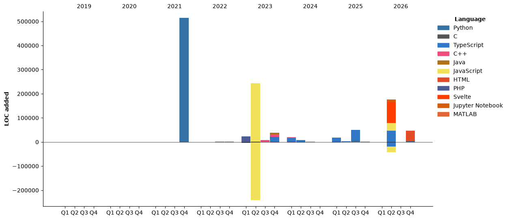

<div align="center">
  
</div>

# Hi there, I'm Ratchanon B. 👋
[](https://www.linkedin.com/in/ratchanon-buachum/)
[](https://hits.sh/github.com/nonnnz/hits/)

I am a Computer Science student at **King Mongkut's University of Technology North Bangkok (KMUTNB)** and currently a **Part-time AI & Full Stack Developer**

### 🔭 Focus & Interests
* **AI & Deep Learning:** Developing intelligent systems and exploring robotics.
* **Cybersecurity:** Building secure infrastructures and threat intelligence.
* **Web Development:** Full Stack development with a focus on security.

### 🚀 Current Projects & Activities
* **AI-Powered Threat Intelligence Platform:** Building a system to identify and mitigate digital threats.
* **NSC 2025:** Developing OAx, an AI-powered retail assistant using local LLMs (Ollama) and RAG for inventory management.
* **Sakura Science Program:** Researching and engineering Deep Learning control systems for Robotics at Gunma University, Japan.

## 🛠 Coding Activity
<!--START_SECTION:waka-->


**I'm a Night 🦉** 

```text
🌞 Morning                60 commits          ███░░░░░░░░░░░░░░░░░░░░░░   12.45 % 
🌆 Daytime                125 commits         ██████░░░░░░░░░░░░░░░░░░░   25.93 % 
🌃 Evening                162 commits         ████████░░░░░░░░░░░░░░░░░   33.61 % 
🌙 Night                  135 commits         ███████░░░░░░░░░░░░░░░░░░   28.01 % 
```
📅 **I'm Most Productive on Sunday** 

```text
Monday                   57 commits          ███░░░░░░░░░░░░░░░░░░░░░░   11.83 % 
Tuesday                  94 commits          █████░░░░░░░░░░░░░░░░░░░░   19.50 % 
Wednesday                92 commits          █████░░░░░░░░░░░░░░░░░░░░   19.09 % 
Thursday                 45 commits          ██░░░░░░░░░░░░░░░░░░░░░░░   09.34 % 
Friday                   56 commits          ███░░░░░░░░░░░░░░░░░░░░░░   11.62 % 
Saturday                 35 commits          ██░░░░░░░░░░░░░░░░░░░░░░░   07.26 % 
Sunday                   103 commits         █████░░░░░░░░░░░░░░░░░░░░   21.37 % 
```


📊 **This Week I Spent My Time On** 

```text
🕑︎ Time Zone: Asia/Bangkok

💬 Programming Languages: 
Python                   19 hrs 15 mins      ██████████░░░░░░░░░░░░░░░   39.61 % 
Markdown                 18 hrs 1 min        █████████░░░░░░░░░░░░░░░░   37.07 % 
Other                    4 hrs 37 mins       ██░░░░░░░░░░░░░░░░░░░░░░░   09.52 % 
TypeScript               1 hr 43 mins        █░░░░░░░░░░░░░░░░░░░░░░░░   03.54 % 
JSON                     1 hr 27 mins        █░░░░░░░░░░░░░░░░░░░░░░░░   02.99 % 

🔥 Editors: 
Zed                      19 hrs 55 mins      ██████████░░░░░░░░░░░░░░░   40.98 % 
VS Code                  15 hrs 47 mins      ████████░░░░░░░░░░░░░░░░░   32.48 % 
Claude Code              12 hrs 54 mins      ███████░░░░░░░░░░░░░░░░░░   26.54 % 

💻 Operating System: 
Mac                      45 hrs 9 mins       ███████████████████████░░   92.88 % 
Linux                    3 hrs 27 mins       ██░░░░░░░░░░░░░░░░░░░░░░░   07.12 % 
```

**I Mostly Code in TypeScript** 

```text
TypeScript               8 repos             ███████░░░░░░░░░░░░░░░░░░   28.57 % 
Python                   6 repos             █████░░░░░░░░░░░░░░░░░░░░   21.43 % 
JavaScript               3 repos             ███░░░░░░░░░░░░░░░░░░░░░░   10.71 % 
HTML                     3 repos             ███░░░░░░░░░░░░░░░░░░░░░░   10.71 % 
Svelte                   1 repo              █░░░░░░░░░░░░░░░░░░░░░░░░   03.57 % 
```


**Timeline**




 Last Updated on 12/11/2026 08:56:02 UTC
<!--END_SECTION:waka-->

---

### 📫 Connect with me
* **Email:** contact@nonnnz.dev
