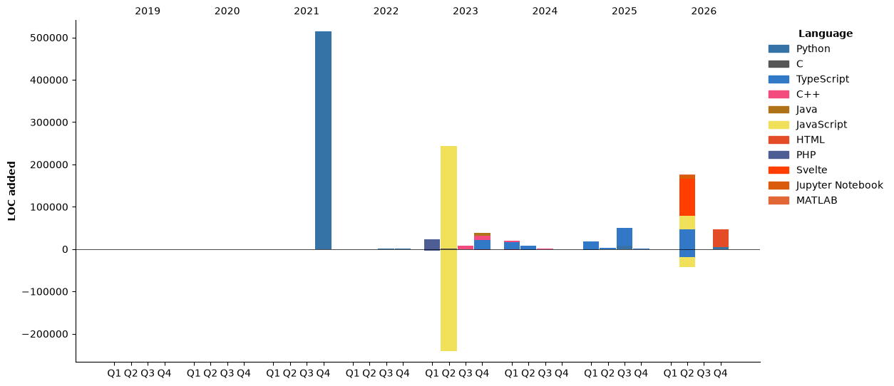

<div align="center">
  
</div>

# Hi there, I'm Ratchanon B. 👋
[](https://www.linkedin.com/in/ratchanon-buachum/)
[](https://hits.sh/github.com/nonnnz/hits/)

I am a Computer Science student at **King Mongkut's University of Technology North Bangkok (KMUTNB)** and currently a **Part-time AI & Full Stack Developer**

### 🔭 Focus & Interests
* **AI & Deep Learning:** Developing intelligent systems and exploring robotics.
* **Cybersecurity:** Building secure infrastructures and threat intelligence.
* **Web Development:** Full Stack development with a focus on security.

### 🚀 Current Projects & Activities
* **AI-Powered Threat Intelligence Platform:** Building a system to identify and mitigate digital threats.
* **NSC 2025:** Developing OAx, an AI-powered retail assistant using local LLMs (Ollama) and RAG for inventory management.
* **Sakura Science Program:** Researching and engineering Deep Learning control systems for Robotics at Gunma University, Japan.

## 🛠 Coding Activity
<!--START_SECTION:waka-->


**I'm a Night 🦉** 

```text
🌞 Morning                60 commits          ███░░░░░░░░░░░░░░░░░░░░░░   12.40 % 
🌆 Daytime                125 commits         ██████░░░░░░░░░░░░░░░░░░░   25.83 % 
🌃 Evening                162 commits         ████████░░░░░░░░░░░░░░░░░   33.47 % 
🌙 Night                  137 commits         ███████░░░░░░░░░░░░░░░░░░   28.31 % 
```
📅 **I'm Most Productive on Sunday** 

```text
Monday                   57 commits          ███░░░░░░░░░░░░░░░░░░░░░░   11.78 % 
Tuesday                  94 commits          █████░░░░░░░░░░░░░░░░░░░░   19.42 % 
Wednesday                92 commits          █████░░░░░░░░░░░░░░░░░░░░   19.01 % 
Thursday                 45 commits          ██░░░░░░░░░░░░░░░░░░░░░░░   09.30 % 
Friday                   58 commits          ███░░░░░░░░░░░░░░░░░░░░░░   11.98 % 
Saturday                 35 commits          ██░░░░░░░░░░░░░░░░░░░░░░░   07.23 % 
Sunday                   103 commits         █████░░░░░░░░░░░░░░░░░░░░   21.28 % 
```


📊 **This Week I Spent My Time On** 

```text
🕑︎ Time Zone: Asia/Bangkok

💬 Programming Languages: 
Python                   31 hrs 59 mins      █████████░░░░░░░░░░░░░░░░   34.33 % 
Markdown                 31 hrs 25 mins      ████████░░░░░░░░░░░░░░░░░   33.73 % 
Go                       9 hrs 2 mins        ██░░░░░░░░░░░░░░░░░░░░░░░   09.71 % 
TypeScript               7 hrs 48 mins       ██░░░░░░░░░░░░░░░░░░░░░░░   08.38 % 
Other                    7 hrs 16 mins       ██░░░░░░░░░░░░░░░░░░░░░░░   07.81 % 

🔥 Editors: 
Zed                      43 hrs 51 mins      ████████████░░░░░░░░░░░░░   47.07 % 
Claude Code              28 hrs 29 mins      ████████░░░░░░░░░░░░░░░░░   30.58 % 
Exec Wakatime            11 hrs 30 mins      ███░░░░░░░░░░░░░░░░░░░░░░   12.36 % 
VS Code                  9 hrs 18 mins       ██░░░░░░░░░░░░░░░░░░░░░░░   09.99 % 
OpenCode                 0 secs              ░░░░░░░░░░░░░░░░░░░░░░░░░   00.01 % 

💻 Operating System: 
Mac                      74 hrs 5 mins       ████████████████████░░░░░   79.52 % 
Linux                    19 hrs 4 mins       █████░░░░░░░░░░░░░░░░░░░░   20.48 % 
```

**I Mostly Code in TypeScript** 

```text
TypeScript               8 repos             ███████░░░░░░░░░░░░░░░░░░   28.57 % 
Python                   6 repos             █████░░░░░░░░░░░░░░░░░░░░   21.43 % 
JavaScript               3 repos             ███░░░░░░░░░░░░░░░░░░░░░░   10.71 % 
HTML                     3 repos             ███░░░░░░░░░░░░░░░░░░░░░░   10.71 % 
Svelte                   1 repo              █░░░░░░░░░░░░░░░░░░░░░░░░   03.57 % 
```


**Timeline**




 Last Updated on 19/11/2026 09:36:50 UTC
<!--END_SECTION:waka-->

---

### 📫 Connect with me
* **Email:** contact@nonnnz.dev
